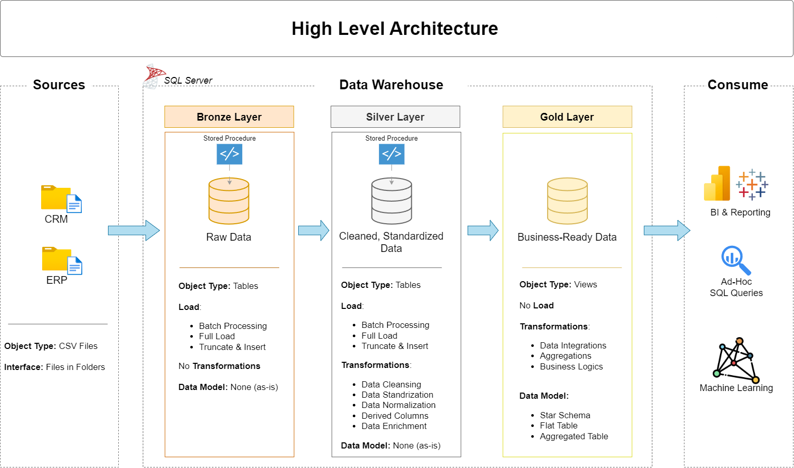

# Data Warehouse and Analytics Project

Welcome to the **Data Warehouse and Analytics Project** repository! 🚀  
This project demonstrates a comprehensive data warehousing and analytics solution built from scratch using **SQL Server** and **T-SQL**, from raw data ingestion to star-schema dimensional modeling.

---

## 🏗️ Data Architecture



The data warehouse follows the **Medallion Architecture** across three layers:

1. **Bronze Layer (Raw Data):** Ingests raw data as-is from external `CRM` and `ERP` CSV files into SQL Server tables via `BULK INSERT` stored procedures (`bronze.load_bronze`).
2. **Silver Layer (Cleansed & Standardized Data):** Performs deduplication, data cleansing, standardization, normalization, and data type casting (`silver.load_silver`).
3. **Gold Layer (Business-Ready Data):** Models cleansed data into an analytics-ready **Star Schema** (`gold.dim_customers`, `gold.dim_products`, `gold.fact_sales`) implemented as SQL Views with surrogate keys.

---

## 📂 Repository Structure

```text
sql-data-warehouse-project/
├── datasets/                     # Raw ERP and CRM CSV datasets
├── docs/                         # Architecture diagrams, data model, and documentation
│   ├── data_architecture.png
│   ├── data_flow.png
│   ├── data_integration.png
│   ├── data_model.png
│   ├── data-catalog.md
│   ├── naming_conventions.md
│   └── requirements.md
├── scripts/                      # SQL scripts for DDL and ETL pipelines
│   ├── bronze/                   # Bronze DDL and BULK INSERT procedure
│   ├── silver/                   # Silver DDL and transformation procedure
│   ├── gold/                     # Gold Star Schema views (DDL)
│   └── init_database.sql         # Database and schema initialization
├── tests/                        # Data quality and referential integrity checks
│   ├── quality_checks_silver.sql
│   └── quality_checks_gold.sql
├── LICENSE
└── README.md
```

---
## 🛠️ Tools & Technologies
* **Database**: Microsoft SQL Server Express
* **Client / IDE**: SQL Server Management Studio (SSMS)
* **Language**: T-SQL (Stored Procedures, Views, Window Functions, CTEs, Error Handling)
* **Documentation & Modeling**: Draw.io, Markdown
* **Version Control**: Git & GitHub

## 🚀 Project Requirements

### Building the Data Warehouse (Data Engineering)

#### Objective
Develop a modern data warehouse using SQL Server to consolidate sales data, enabling analytical reporting and informed decision-making.

#### Specifications
* **Data Sources**: Import data from two source systems (ERP and CRM) provided as CSV files.
* **Data Quality**: Cleanse and resolve data quality issues prior to analysis.
* **Integration**: Combine both sources into a single, user-friendly data model designed for analytical queries.
* **Scope**: Focus on the latest dataset only; historization of data is not required.
* **Documentation**: Provide clear documentation of the data model to support both business stakeholders and analytics teams.

---

### BI: Analytics & Reporting (Data Analytics)

#### Objective
Develop SQL-based analytics to deliver detailed insights into:
* **Customer Behavior**
* **Product Performance**
* **Sales Trends**

These insights empower stakeholders with key business metrics, enabling strategic decision-making.

---

## 🛡️ License

This project is licensed under the [MIT License](LICENSE)..

## 🌟 About Me

Hi there! I'm **Pruthvisinh Padhiyar**, a B.Tech IT student and aspiring **Data Engineer**, passionate about data engineering, building efficient data pipelines, and transforming raw data into meaningful insights.
